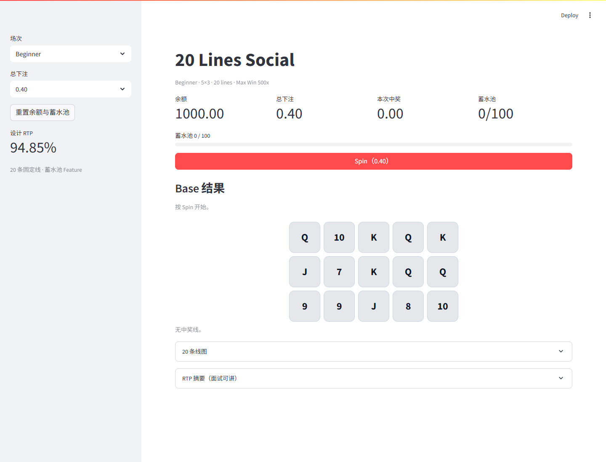

# Social Slots - 20 Lines

[](https://github.com/xufushen521/social-slots-20lines/actions/workflows/tests.yml)

一个可直接运行的 5x3、20 固定线 Social Slots 数值原型。项目提供 Beginner 与 Advanced 两档体验，共用 20 条线图、100 分蓄水池与 x2 Free Spin。

本项目仅用于数值设计、机制验证和求职作品展示，不包含真钱、兑换或提现功能。



## 下载后启动

### Windows

1. 点击页面右上角 `Code`，选择 `Download ZIP`。
2. 解压 ZIP。
3. 双击 `start.bat`。
4. 首次运行会自动创建虚拟环境并安装 Streamlit，之后打开浏览器。
5. 如果没有自动打开，请访问 `http://localhost:8501`。

运行条件：Windows 10/11、Python 3.10 或更高版本、首次安装依赖时需要网络。

### macOS / Linux

```bash
python3 -m venv .venv
source .venv/bin/activate
python -m pip install -r requirements.txt
python -m streamlit run app.py
```

## 玩法

- 盘面：5x3，20 条固定线。
- 普通符号：K、Q、J、10、9、8、7。
- 赔率口径：总下注倍数 / 中奖线。
- 蓄水池：每条中奖线增加 `max(1, round(赔率 x 2))` 分。
- 累计 100 分触发 1 次 Free Spin，普通线奖 x2。
- 触发后蓄水池清零，不保留溢出。
- Beginner 与 Advanced 使用不同轴权重和顶部赔率。

## 数值结果

| 指标 | Beginner | Advanced |
|---|---:|---:|
| 精确 Base RTP | 91.54% | 91.64% |
| 蓄水池贡献 | 3.31% | 2.80% |
| 设计总 RTP | 94.85% | 94.44% |
| 1M 模拟总 RTP | 94.39% | 93.37% |
| Hit rate | 31.78% | 25.12% |
| SD | 2.79 | 4.91 |
| 蓄水池触发率 | 1.86% | 1.48% |
| Max Win | 500x | 2000x |

## 文档

- [模型拆解 DOCX](docs/20lines_模型拆解.docx)
- [可复算工作簿 XLSX](docs/20lines_模型工作簿.xlsx)
- [机制与商业流程 Draw.io](docs/20lines_机制与商业流程.drawio)

`.drawio` 文件可在 [diagrams.net](https://app.diagrams.net/) 中打开。

## 目录

```text
app.py                 Streamlit 界面
config.json            线图、轴权重、赔率与蓄水池参数
engine/                线结算、精确 RTP、模拟与配置校验
scripts/               精确计算与 1M 模拟脚本
tests/                 5 个单元测试
docs/                  机制拆解、工作簿与流程图
```

## 测试

```bash
python -m unittest discover -s tests -v
```

计算结果属于可复算的原型参数，不是商业机台认证结果。代码和 `config.json` 是当前版本的事实来源。

作者：许富深
